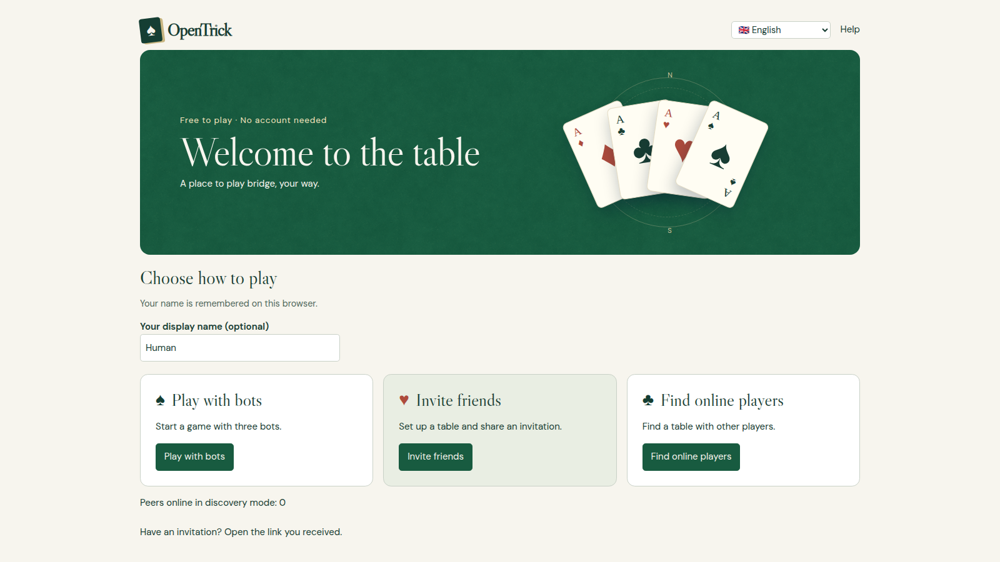
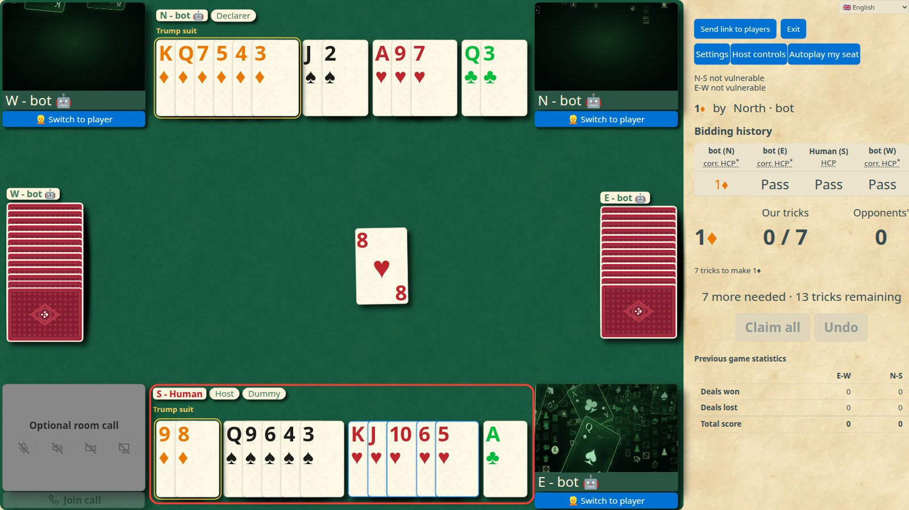
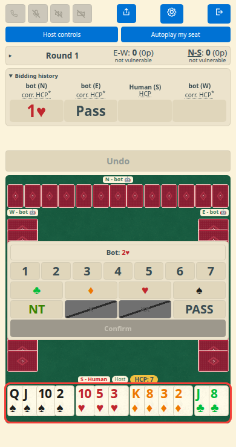

# OpenTrick

OpenTrick is a free, four-player contract bridge game for your browser.
Play on a computer or phone; no account is required.

**[Play OpenTrick](https://dvolgyes.github.io/opentrick/)**

## Start a game

Enter an optional display name, then choose how to play:

- **Play with bots** starts a solo game with three bots.
- **Invite friends** lets you choose seats and fill the remaining seats with friends, bots, or online players.
  Create the table and send the invitation link to your friends.
- **Find online players** matches you with other people waiting for a game.

To join a friend's table, open the invitation link they send you.
The full link contains the key to the table, so share it only with people you want to invite.

## At the table

OpenTrick deals the cards, guides bidding and play, and keeps duplicate scores.
It supports undo requests, claims, and autoplay for a player who needs a break.
In solo games, select **Next board** when you are ready, or enable automatic advance in Settings.

Private games support optional audio and video calls.
Calls are currently disabled in community games.
All participants must take a seat; there is no spectator mode.

## Settings and bots

Use **Settings** to change the language, appearance, card sizes, bidding confirmation, animations, and bot timing.
You can also choose the displayed hand point count and the bot bidding engine.
The bidding reference is a guide for players; it does not explain every call made by a learned bot.

Bots run in the browser without an account or API key.
Their bidding policies and card-play engine are described in the [bidding engine guide](docs/bidding-engine.md) and [card engine guide](docs/card-engine.md).

## Connections and privacy

OpenTrick is a static site with no game server or database.
Browsers use public discovery services to find one another and exchange game data over WebRTC.
Game state is stored in the players' browsers, and reopening a link in the same browser can restore a session.
Clearing site data removes locally saved recovery information.

Each seated browser receives the full bridge state, so the game is not cheat-resistant.

## Star history

## License

OpenTrick is all rights reserved, with free access to the hosted game.
The source code and original assets are not licensed for reuse or independent hosting; see [LICENSE](LICENSE).
Third-party components retain their own licenses, listed in the [component inventory](public/licenses/components.json).
