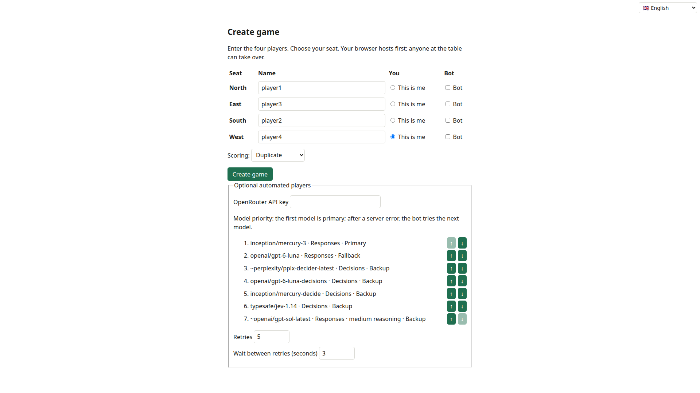
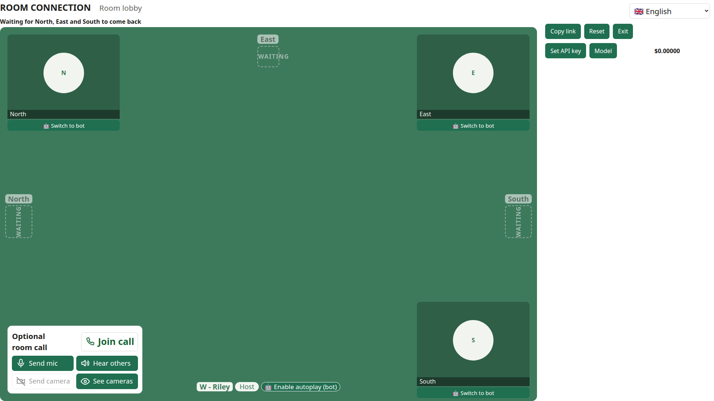
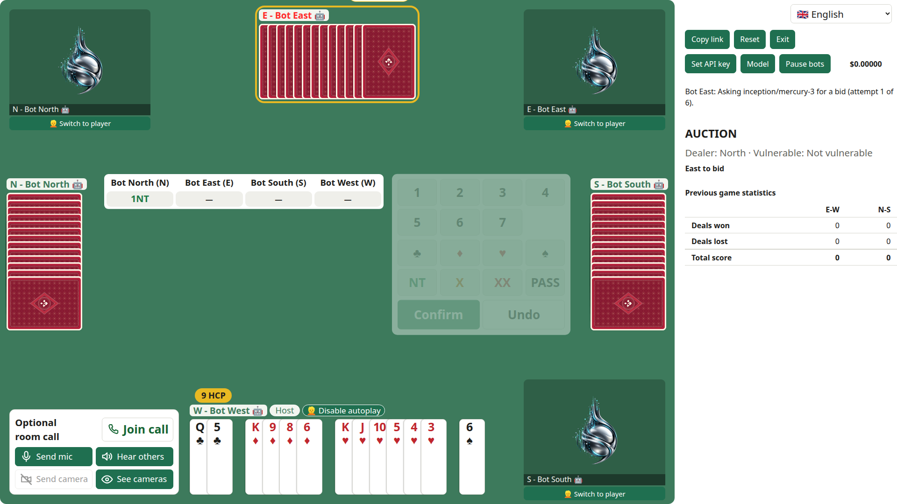
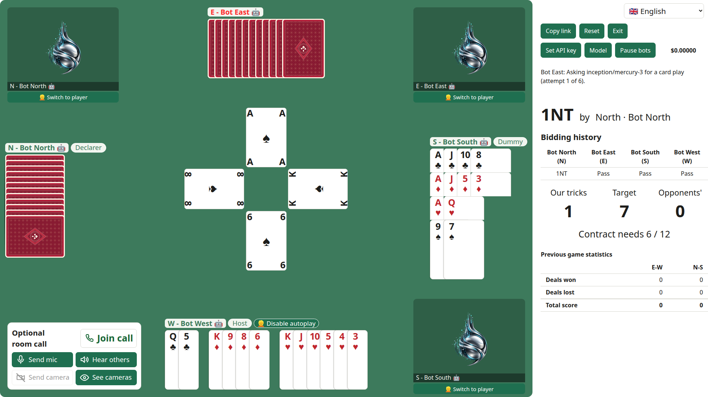
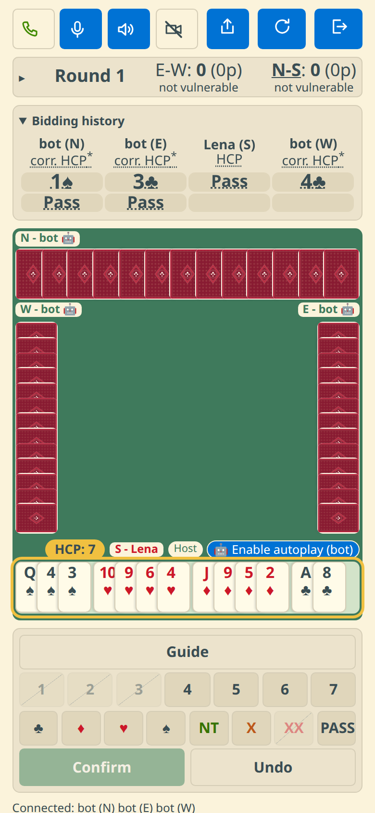
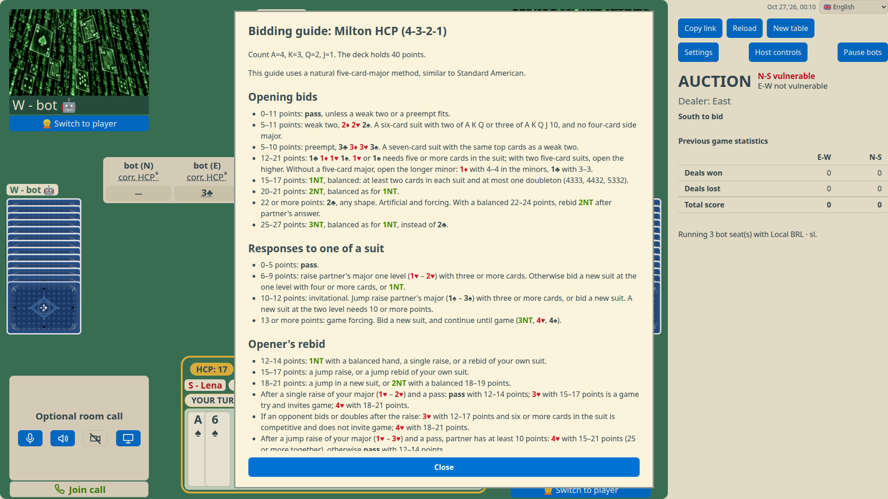
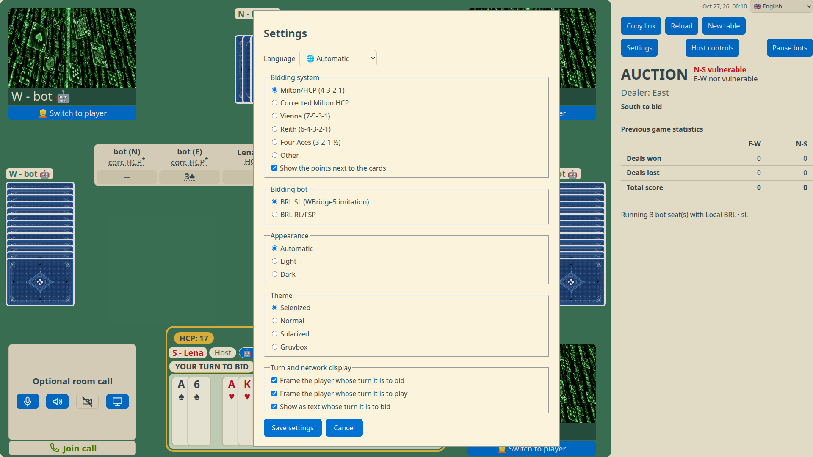

# OpenTrick

OpenTrick is a four-player contract bridge game that runs in the browser.
It supports human players, optional voice and video calls, and local browser bots.
You can play a solo game with three bots, or a multiplayer game with friends.
The game handles bidding, trick play, duplicate scoring, undo requests, and claims with opponent approval.

**Play:** [dvolgyes.github.io/opentrick](https://dvolgyes.github.io/opentrick/)
**Source:** [github.com/dvolgyes/opentrick](https://github.com/dvolgyes/opentrick)

The game is a static site with no game server or database.
Players find each other through public WebTorrent trackers, Nostr relays and MQTT brokers, then exchange game data directly over WebRTC.
One browser coordinates the table at a time; every seated browser stores a copy so another can take over if needed.
The table key is in the link fragment and is not sent to the web server.

## How to play

OpenTrick is a four-player contract bridge table.
North and South form one partnership, and East and West form the other.
Players use the auction to agree a contract, then play tricks to try to make it.
The game deals the cards, guides the auction and card play, and keeps the duplicate score.

### Play a solo game

1. Open [OpenTrick](https://dvolgyes.github.io/opentrick/) and enter your name beside **Name:**.
2. Select **Play with bots**.
   You take the South seat, and bots take North, East, and West.
3. Play the board with the bots, using the same auction and card play as a table.

A solo game needs no friends, no invitation link, and no other browser.
Bots use the bidding policy and play settings chosen in the create screen and the settings dialog.

### Create a table and invite friends

1. Open [OpenTrick](https://dvolgyes.github.io/opentrick/) and fill in a name for each seat: North, East, South, and West.
2. Select **This is me** beside the seat you want to play.
3. Select **Create game**.
   Your browser creates the table, takes your seat, and copies the room link when clipboard access is available.
4. Use **Copy link** at the table to copy the shared link again, then send the full link to your friends in a private message.
5. Each friend opens the link and selects one of the available seats.
   If only one seat remains, OpenTrick takes it automatically.



The room link is the invitation key.
Room discovery can announce that a room exists, but a person still needs the complete link to join because the room password is carried in the link fragment.
Treat the full link like a password: send it only to people you want at the table.
Do not post it publicly.



### Find community players

Use the compact **Name: [name] Play with bots / Play online** row in the **Single player** section to choose how to play alone.
Select **Play online** to enter public matchmaking.
The creation and community waiting pages show the number of other browsers directly connected to this browser in the discovery room.
This local count can differ between browsers and does not count everyone who is online.
The browser joins discovery on the creation page, reuses that connection for matchmaking, and leaves it for a solo or private game.
The waiting page for a solo search offers **Create new game**; group invitations are available only for groups with reserved friends.
Bookmark `/` for the site root, `/create` for table setup, `/solo` to start with bots, and `/join` to enter online matchmaking using the saved name.
On a project site, these paths follow the deployment directory, for example `/opentrick/join`.
The build includes static entry pages, so these bookmarks also work when opened directly on GitHub Pages.
For a group, use the regular four-seat creation form.
The centre buttons, **Bots**, **Online players**, and **Both**, preset the two checkboxes on unnamed seats.
A name reserves that seat for a human friend and clears both checkboxes.
The presets leave named seats and the creator's seat unchanged.
Each unnamed seat can also be configured separately; neither checkbox selected reserves it for an invited friend.
Only a human seat can be the creator's host seat.
Select **Create game**, then use **Copy group invitation** to bring reserved friends to their chosen seats.
Matching starts automatically after the invited group has assembled.
Community players can use separate tabs in the same browser.
Each player's game address keeps their own seat and recovery record; groups use **Copy group invitation** to invite their reserved friends.

Every waiting browser endorses its own group in the shared discovery room.
Compatible groups merge automatically without an extra readiness or acceptance step.
The larger group keeps its room; a stable identifier breaks equal-size ties.
The resulting game uses the surviving host's selected bidding engine.
Compatible choices and seat rotations are randomized, while existing relative seating is preserved.
Two solos become an opposite pair when their seat choices permit it; an explicitly restricted layout can require adjacent seats instead.
Opposite pairs can combine with opposite pairs, adjacent pairs with adjacent pairs, and three players with a solo.
Opposite and adjacent pairs cannot combine without changing their existing seating.

Both seat choices are checked during every merge, including the remaining empty seats.
An online-only seat never becomes a bot, and a bot-only seat never receives an online player.
Choosing **Both** allows bot fallback after a default two-minute search.
The **Bot wait** control can adjust this to 0–60 minutes.
Empty seats fill only when every human's seat choices permit bots and every human's own wait has elapsed.
Time waiting for invited friends does not count; accumulated search time survives merges and reloads.
With four humans, or unanimous bot fallback, the group starts a game and leaves discovery after game admission.
The first deal waits for all agreed seats.
Discovery does not list games already in progress or recruit replacements automatically.

Community games disable audio and video calls.
After a human is disconnected for the recovery grace period, the host runs a temporary bot for that seat.
The returning player keeps the reservation and resumes control at a board boundary.
Community seat reservations remain assigned to the original browser identity for the game; a fresh browser cannot take one through a copied game link.
Private invitation games retain their existing call and autoplay controls.

Matchmaking progress and transfer votes are saved locally before they are acknowledged.
Reload the same browser to recover a pending merge or game.
A saved merge vote cannot expire into a competing table: if another participant is unreachable, recovery can wait for that participant.
An absent member of a forming group remains reserved, including its host.
The remaining members wait for that browser to return rather than silently excluding it.
Clearing site data loses these reservations and recovery records.

This first community version targets small, casual groups.
Discovery refreshes every five seconds and expires announcements after twenty seconds.
It keeps at most twelve advertisements and leaves discovery if more than eleven remote peers connect.
This is a local limit, not a globally enforced lobby capacity or a hard limit on pending WebRTC connections.
The browser test exercises twelve local browser contexts with real WebRTC and simulated relays; it does not establish cross-network or mobile capacity.
As with private games, each seated browser receives the full bridge state, so community play is not cheat-resistant.

Community formation uses its own versioned messages and game namespace.
Public advertisements contain membership and seating, but no game key; invitations are sent only to proposed participants.
Messages have size and rate limits, and receivers validate membership, revisions, consent and seat assignments before acting.
Transfer records are separate from the bridge log so a game host election cannot roll back a room transfer.
Only the community admission configuration and temporary-cover seat event extend the game protocol.
Older clients cannot join community rooms; returning to an older build leaves existing private-game behavior intact but cannot continue a community game.

### Take a seat and play

The room opens at a seat-selection screen when more than one seat is free.
Choose the seat the host agreed with you.
If a seat is already held by an active browser, choose another available seat or ask its player to release it.
Reopening the link in the same browser normally restores that browser's seat.

When all four seats are ready, the table deals a board automatically, then players bid in turn.
The final contract names a trump suit (or no trump), a level, and a declarer.
After the opening lead, declarer's partner becomes the dummy: their hand is shown on the table, and declarer plays both hands.
In a human–robot partnership, the human selects cards from both hands, even when the human is dummy, unless autoplay is enabled.
The defenders play together to stop the contract, while declarer tries to make it.
The table records tricks and duplicate scores as the hand finishes.
Vulnerable partnerships and their player names in the bidding history are red.





On a phone, or in a browser window narrower than 900 pixels, the table uses a compact layout.
Your hand is at the bottom of the board, and the bid box is below it.
When you declare, dummy's hand is at the top of the board, and you tap its cards there.
The room controls are below the table, so scroll down to reach them.



You must take one of the four player seats to use the table.
There is no spectator or kibitz mode, so people who are not seated cannot watch the cards or the auction from inside the room.

### Use bots

Bots can fill seats for a game, or the host can turn on autoplay for a player who needs to step away temporarily.
For a permanent bot seat, select **Bot** for that seat while creating the table.
For a temporary substitute, the host can enable the bot for the player's seat from the table controls, then turn it off when the player returns.
The player keeps their seat and stays in the room call while the bot handles bridge actions.

Bots bid with a local bidding engine and play cards with a local DDS engine.
Choose **Bidding bot** when creating a table.
The **BRL SL (WBridge5 imitation)** option is the default, because human partners and opponents can read its natural calls.
BRL's RL/FSP learned system remains available for bot partnerships and future work.
Both policies run entirely in a browser worker, with no Python runtime or API key.
Their learned conventions can differ from the standard guide; see [the bidding engine guide](docs/bidding-engine.md) for partnership limits and evaluation.
The **Guide** button in the bid box opens the bidding guide for the bidding system chosen in Settings.



All bots use a local bridge engine for card play.
The card engine samples possible hidden hands, respects shown voids and auction meanings, and evaluates legal cards with the [DDS double-dummy solver](https://github.com/bookchris/bridge-dds-js) compiled to WebAssembly.
It sees only its own hand, exposed dummy, and public play and auction history.
The host runs the search in a background worker, so the table remains responsive.
Card play requires no model requests and has no API cost.
See [the engine guide](docs/card-engine.md) for its budgets, verification, and strength limits.

Bots need no external account, and their decisions have no API cost.
The host loads the selected bidding policy's 14.7 MB weights from the static site on first use.

### Call and finding players

The table includes an optional audio and video call for room members.
Each player chooses whether to join the call and whether to send a microphone or camera.
On phones and tablets, and in a browser window narrower than 900 pixels, the call uses a compact form without video; audio calls remain available.
The compact form can still send the camera, but it does not show video tiles.
The call is separate from bridge actions, so using autoplay does not make the player leave the call.
The call has no kibitz or spectator access.

Private games use invitation links and support calls.
Community matchmaking finds other waiting players and disables calls.

### Save and reuse a room link

You can bookmark or save the shared table link and reuse it with regular partners.
The link keeps the seat names and table setup, so it can start a fresh table for the same group without creating and distributing another invitation.
The current game state is stored in the players' browsers, not on a game server.
After about 8 hours without activity on a device, its saved table expires; starting again from the saved link creates a fresh session and does not restore the previous deal, score, or seat claims.
Use **Copy link** in the table if you need to share the invitation again.

## Settings

Open **Settings** to change these options.



The page language can be one of English, German, Spanish, French, Hungarian, Italian, Norwegian, Dutch, or Portuguese.
The bidding system sets the point count and the bidding guide.
The colour theme can be Selenized, Normal, Solarized, or Gruvbox, each with a light and a dark palette.
The appearance can also follow your system's light or dark preference.
Suit and rank font sizes are S (75%), M (the original size), L (125%), XL (150%), XXL (175%), and XXXL (200%).
The size applies to cards, bids, contracts, and notation in hints and guides.
Turn display, card points, the mobile view for portrait windows, and bot play time are also set here.
Settings are kept in this browser and are never sent to the table.

## Development

Use Node.js 22, as in the deploy workflow.

```sh
npm ci
npm run dev          # local development server
npm run build        # prepare bidding model files, typecheck, and build dist/
npm test             # unit tests (Vitest)
npm run test:e2e     # browser tests (Playwright)
npm run lint         # Biome checks
npm run typecheck    # TypeScript without emit
npm run bot          # run a Node bot that joins a table
npm run demo:bot     # demo bot script
npm run benchmark:bidding   # bidding benchmark; also benchmark:sayc, benchmark:play, benchmark:3nt
```

`npm run prepare:bidder` downloads the two bidding model files (14.7 MB each) into `public/bot-models/` when they are missing.
The `build` and `test` scripts run it first.

Install the Git hooks with `pre-commit install`, then run `pre-commit run --all` before committing.
The hooks run Biome, reject DOM HTML sinks such as `innerHTML`, and reject colour literals outside the theme tokens in `src/ui/themes.css`.

Pushing to `main` deploys the static site to GitHub Pages through [the deploy workflow](.github/workflows).
Design notes are in [docs/](docs/), and architecture decisions are in [docs/adr/](docs/adr/).

## License

OpenTrick is all rights reserved, with free access to play the hosted game.
The source code and original assets are not licensed for reuse or independent hosting.
See [LICENSE](LICENSE) for the terms.
Third-party engine components and vendored adaptations retain their own licenses, recorded in [the component inventory](public/licenses/components.json) with distributed license texts and notices.
GitHub's terms still allow users to view and fork a public repository ([GitHub licensing documentation](https://docs.github.com/en/repositories/managing-your-repositorys-settings-and-features/customizing-your-repository/licensing-a-repository)).
